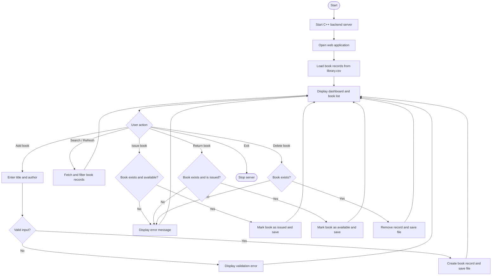

# Library Management System – Flowchart

## Flow explanation

1. The C++ server starts and loads previously saved book records.
2. The browser requests the current list of books from the backend.
3. The user can add, search, issue, return or delete a book.
4. The backend validates each operation and updates the data file.
5. The frontend refreshes the catalogue and dashboard after a successful operation.
